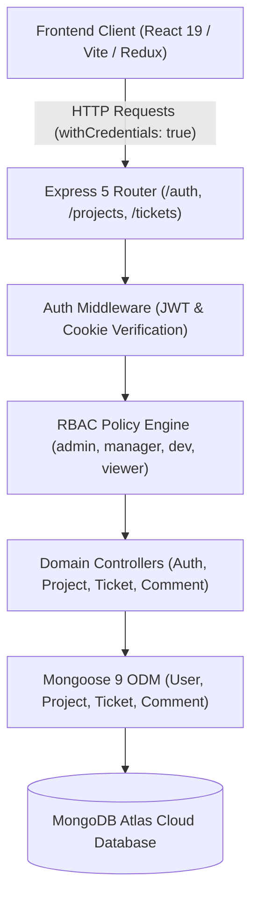
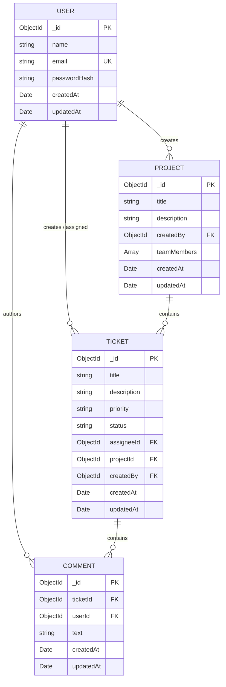

# ⚡ BugBoard — Backend API & Issue Tracking Engine

A robust, enterprise-grade RESTful API server for the **BugBoard** Issue & Project Tracking ecosystem. Built on **Node.js**, **Express 5**, **Mongoose**, **MongoDB Atlas**, **JWT**, and **bcrypt**, BugBoard delivers low-latency ticket management, multi-role workspace authorization (**Admin**, **Manager**, **Developer**, **Viewer**), drag-and-drop Kanban state persistence, real-time activity discussion timelines, and rigorous anti-spam validation.

---

## 🌐 Server Health & Base URLs

| Target | Host / URL | Status Check |
| :--- | :--- | :--- |
| **Live Frontend Client** | [https://project-management-frontend-z4a6.vercel.app](https://project-management-frontend-z4a6.vercel.app) | Production SPA (CORS Whitelisted) |
| **Local API Server** | `http://localhost:3000` | `GET /health` |
| **Local Frontend Client** | `http://localhost:5173` | Vite Dev Server (CORS Whitelisted) |
| **Database Engine** | `MongoDB Atlas (Cluster0)` | Mongoose auto-reconnect & SRV DNS fallback |

---

## 📋 Table of Contents

- [Overview](#-overview)
- [System Architecture & Data Flow](#-system-architecture--data-flow)
- [Core Features & Engineering](#-core-features--engineering)
- [Folder Structure](#-folder-structure)
- [Tech Stack](#-tech-stack)
- [Database Architecture & Mongoose Models](#-database-architecture--mongoose-models)
- [REST API Reference](#-rest-api-reference)
- [Role-Based Access Control (RBAC) Matrix](#-role-based-access-control-rbac-matrix)
- [Security & Architecture Hardening](#-security--architecture-hardening)
- [Installation & Local Setup](#-installation--local-setup)
- [Available Scripts](#-available-scripts)
- [Dependencies](#-dependencies)
- [Automated Testing & Verification](#-automated-testing--verification)
- [Authors & License](#-authors--license)

---

## 🔍 Overview

The BugBoard Backend coordinates all project workspaces, ticket lifecycles, team collaboration, and activity audit trails. Designed under a clean architectural model without legacy `/api` prefixes, every route is mounted cleanly at the top-level (e.g. `/auth`, `/projects`, `/tickets`).

### What It Does
- **Authentication & Session Security**: Issues cryptographically signed JSON Web Tokens (JWT) stored in HTTP-only, SameSite cookies with bcrypt password hashing (10 salt rounds).
- **Anti-Spam & Input Hardening**: Rejects malicious registrations using strict regex rules against numeric domains, repeating character sequences, and automated sequential username patterns.
- **Multi-Tenant Workspaces**: Projects manage isolated member rosters with four distinct role tiers (`admin`, `manager`, `developer`, `viewer`).
- **Granular Ticket Lifecycle**: Tracks bugs and tasks through strict status transitions (`todo` → `in_progress` → `done`) and fixed priority rankings (`low`, `medium`, `high`).
- **Kanban Drag-and-Drop Persistence**: Provides instantaneous status synchronization via `PATCH /tickets/:ticketId` with optimistic Redux rollback support.
- **Threaded Ticket Comments**: Chronological activity timeline with author attribution, relative timestamps, and cascade cleanup upon ticket deletion.
- **Dynamic Search & Multi-Criteria Filtering**: Dynamic query parameter engine supporting status, priority, assignee, unassigned, and case-insensitive ReDoS-safe keyword search.

---

## 🔄 System Architecture & Data Flow



---

## ✨ Core Features & Engineering

### 🔐 1. Authentication & Session Management
- **Bcrypt Hashing**: Passwords hashed with 10 salt rounds before persistence; plain text passwords never touch the database.
- **HTTP-Only Cookies & Bearer Tokens**: Dual support for browser-managed HTTP-only cookies and `Authorization: Bearer <token>` headers for cross-origin requests.
- **Session Introspection**: `GET /auth/me` validates active tokens and returns sanitized profile objects (excluding `passwordHash`).

### 🛡️ 2. Anti-Spam & Payload Validation
- **Universal Alphabetic Names**: Enforces `/^[a-zA-Z\u00C0-\u017F]+(?:\s[a-zA-Z\u00C0-\u017F]+)*$/` to prevent symbol injection and malformed names.
- **Numeric Domain Blocking**: Rejects email registrations from purely numeric domains (`/@([0-9]+)\.[a-zA-Z]{2,}$/`).
- **Repeating Character Defense**: Blocks spam usernames containing 4+ identical sequential characters (`/(.)\1{3,}/`).
- **Sequential Pattern Detection**: Blocks automated bots using common sequential character sequences (`abcde`, `12345`, `cdefg`).

### 📁 3. Project & Workspace Management
- **Creator Ownership**: The project creator is permanently assigned full administrative authority.
- **Member Roster**: Team members are attached via `{ userId: ObjectId, role: enum }` subdocuments.
- **Duplicate Protection**: Prevents duplicate member additions with HTTP 400 validation.
- **Email Resolution**: Seamlessly resolves registered user accounts via email query during member invitations.

### 🎫 4. Ticket Lifecycle & Assignment
- **Enum State Constraints**: Strictly validates `status` (`todo`, `in_progress`, `done`) and `priority` (`low`, `medium`, `high`).
- **Project Membership Verification**: Verifies that ticket assignees belong to the target project before assignment.
- **Two-Way Virtual Relationships**: `Ticket.virtual('comments')` and `Project.virtual('tickets')` provide foreign-key mapping without document bloating.

### 📋 5. Kanban State Machine & Persistence
- **Optimistic State Synchronization**: Backend accepts discrete status payloads (`PATCH /tickets/:ticketId { status: 'in_progress' }`), instantly updating MongoDB Atlas.
- **Validation Fallback**: Invalid statuses are rejected with HTTP 400, signaling the frontend to trigger immediate UI rollback.

### 💬 6. Ticket Comments & Activity Timeline
- **Author Attribution**: Comments store `{ ticketId, userId, text }` with populated `userId (name, email)` profiles.
- **Chronological Sorting**: Optimized via compound index `{ ticketId: 1, createdAt: -1 }`.
- **Cascade Deletion**: Deleting a ticket automatically cascades to remove all associated comments (`Comment.deleteMany({ ticketId })`), preventing orphaned records.

### 🔎 7. Dynamic Search & Multi-Criteria Filtering
- **Query Parameter Support**: `GET /projects/:projectId/tickets?status=...&priority=...&assignee=...&search=...`
- **ReDoS-Safe Keyword Search**: Escapes regex special characters before compiling case-insensitive search queries across both `title` and `description`.
- **Unassigned Querying**: Special `assignee=unassigned` parameter queries tickets with `assigneeId: null`.

---

## 📂 Folder Structure

```
backend/
├── config/
│   └── config.js            # MongoDB Atlas connection & Windows DNS SRV fallback
├── controllers/
│   ├── authController.js     # User registration, anti-spam validation, JWT login/logout, /auth/me
│   ├── commentController.js  # Add, retrieve, and delete ticket comments
│   ├── projectController.js  # CRUD projects & team member management
│   └── ticketController.js   # Ticket CRUD, assignment, filtering, search & role-based auth
├── middlewares/
│   └── authMiddleware.js     # JWT verification middleware & role authorization guards
├── models/
│   ├── Comment.js            # Comment Mongoose model with ticketId/userId refs & indexes
│   ├── Project.js            # Project model with teamMembers roles & two-way virtuals
│   ├── Ticket.js             # Ticket model with status/priority enums, text indexes & virtuals
│   ├── User.js               # User model with unique email and bcrypt passwordHash
│   └── index.js              # Central models export barrel
├── routes/
│   ├── authRoutes.js         # /auth routes (register, login, logout, me)
│   ├── projectRoutes.js      # /projects routes (CRUD, members, project tickets)
│   └── ticketRoutes.js       # /tickets routes (CRUD, assignee, comments)
├── .env                      # Environment variables (PORT, MONGO_URI, JWT_SECRET, CLIENT_URL)
├── .gitignore                # Git ignore configuration
├── app.js                    # Server bootstrap, Express 5 setup, CORS & graceful shutdown
├── package.json              # Backend package configuration & dependencies
└── README.md                 # Backend documentation
```

---

## 🛠️ Tech Stack

| Technology | Version | Category | Purpose |
| :--- | :--- | :--- | :--- |
| **Node.js** | `>=18.x` | Runtime | Asynchronous, event-driven JavaScript backend environment |
| **Express** | `^5.3.0` | Framework | High-performance HTTP server with native Promise handling |
| **Mongoose** | `^9.11.4` | ODM | Schema validation, virtual population, and MongoDB Atlas mapping |
| **MongoDB Atlas** | `Cloud` | Database | Multi-cloud distributed NoSQL database |
| **JSON Web Token** | `^9.0.3` | Authentication | Cryptographically signed bearer tokens for stateless authorization |
| **Bcrypt** | `^6.0.0` | Security | Adaptive one-way password hashing algorithm (10 salt rounds) |
| **Cookie Parser** | `^1.4.7` | Middleware | Cookie serialization and extraction for secure sessions |
| **CORS** | `^2.8.6` | Middleware | Cross-Origin Resource Sharing with whitelisted credentials |
| **Dotenv** | `^18.0.10` | Configuration | Environment variable loading from `.env` files |
| **Nodemon** | `^3.1.14` | Dev Tool | Hot-reloading development server |

---

## 🗄️ Database Architecture & Mongoose Models

The MongoDB database utilizes four strictly defined collections:



### Models Directory

| Model | Collection | Key Fields | Indexes | Virtual Relations | Description |
| :--- | :--- | :--- | :--- | :--- | :--- |
| **User** | `users` | `name`, `email`, `passwordHash` | `{ email: 1 }` (Unique) | `projects`, `tickets` | Authenticated team member profile |
| **Project** | `projects` | `title`, `description`, `createdBy`, `teamMembers` | `{ createdBy: 1 }`, `{ 'teamMembers.userId': 1 }` | `tickets` | Project workspace managing member roles |
| **Ticket** | `tickets` | `title`, `description`, `priority`, `status`, `assigneeId`, `projectId`, `createdBy` | `{ projectId: 1, status: 1 }`, `{ projectId: 1, priority: 1 }`, `{ projectId: 1, assigneeId: 1 }`, `{ title: 'text', description: 'text' }` | `comments` | Issue or task tracking item |
| **Comment** | `comments` | `ticketId`, `userId`, `text` | `{ ticketId: 1, createdAt: -1 }` | — | Discussion message on a ticket |

---

## 🌐 REST API Reference

### 1. Authentication (`/auth`)

| Method | Endpoint | Status | Description |
| :--- | :--- | :---: | :--- |
| `POST` | `/auth/register` | `201` | Register new user account with anti-spam name & email validation |
| `POST` | `/auth/login` | `200` | Authenticate user, verify password, return JWT & set secure cookie |
| `POST` | `/auth/logout` | `200` | Clear authentication cookies and terminate session |
| `GET` | `/auth/me` | `200` | Fetch currently authenticated user profile via Bearer token / cookie |

### 2. Project Management (`/projects`)

| Method | Endpoint | Status | Description |
| :--- | :--- | :---: | :--- |
| `POST` | `/projects` | `201` | Create a new project workspace (creator becomes Admin) |
| `GET` | `/projects` | `200` | List all projects accessible to the authenticated user |
| `GET` | `/projects/:projectId` | `200` | Retrieve detailed project metadata and populated member roster |
| `PATCH` | `/projects/:projectId` | `200` | Update project title or description (Admin/Manager only) |
| `DELETE` | `/projects/:projectId` | `200` | Delete project workspace and associated tickets (Creator/Admin only) |
| `POST` | `/projects/:projectId/members` | `200` | Add registered user to project by email with role assignment |
| `DELETE` | `/projects/:projectId/members/:userId` | `200` | Remove member from project workspace |
| `GET` | `/projects/:projectId/tickets` | `200` | List tickets in project with optional filtering and keyword search |

### 3. Ticket Management (`/tickets`)

| Method | Endpoint | Status | Description |
| :--- | :--- | :---: | :--- |
| `POST` | `/tickets` | `201` | Create new ticket in project (Admin, Manager, Developer) |
| `GET` | `/tickets` | `200` | List user's assigned tickets across accessible projects |
| `GET` | `/tickets/:ticketId` | `200` | Retrieve single ticket details, populated assignee, creator, and project |
| `PATCH` | `/tickets/:ticketId` | `200` | Update ticket title, description, priority, or Kanban status |
| `PATCH` | `/tickets/:ticketId/assignee` | `200` | Reassign or unassign ticket to a project team member |
| `DELETE` | `/tickets/:ticketId` | `200` | Delete ticket and cascade delete comments (Admin, Manager, Creator) |

### 4. Ticket Comments (`/tickets/:ticketId/comments`)

| Method | Endpoint | Status | Description |
| :--- | :--- | :---: | :--- |
| `POST` | `/tickets/:ticketId/comments` | `201` | Add a comment to a ticket (Project members only) |
| `GET` | `/tickets/:ticketId/comments` | `200` | Retrieve chronological comment timeline with author avatars & names |
| `DELETE` | `/tickets/:ticketId/comments/:commentId` | `200` | Delete comment (Comment author or Project Admin/Manager only) |

---

## 🛡️ Role-Based Access Control (RBAC) Matrix

BugBoard enforces strict role verification on all state-mutating endpoints:

| Role | Create Tickets | Edit Any Ticket | Delete Own Ticket | Delete Others' Tickets | Add / Remove Members | Delete Project |
| :--- | :---: | :---: | :---: | :---: | :---: | :---: |
| **Project Creator** | ✅ | ✅ | ✅ | ✅ | ✅ | ✅ |
| **admin** | ✅ | ✅ | ✅ | ✅ | ✅ | ❌ |
| **manager** | ✅ | ✅ | ✅ | ✅ | ✅ | ❌ |
| **developer** | ✅ | ✅ | ✅ | ❌ *(HTTP 403)* | ❌ *(HTTP 403)* | ❌ |
| **viewer** | ❌ *(HTTP 403)* | ❌ *(HTTP 403)* | ❌ *(HTTP 403)* | ❌ *(HTTP 403)* | ❌ *(HTTP 403)* | ❌ |

---

## 🔒 Security & Architecture Hardening

- **Payload Size Limiting**: `express.json({ limit: '10kb' })` blocks denial-of-service attempts via payload flooding.
- **HTTP-Only Cookies**: JWTs can be transported in `httpOnly`, `secure`, `SameSite: None/Lax` cookies to prevent XSS-based credential theft.
- **Strict CORS Origin Whitelist**: Restricts API calls strictly to approved client origins (`http://localhost:5173` and production Vercel SPA) with `credentials: true`.
- **ReDoS Mitigation**: Dynamic regex searches safely escape reserved regex characters (`/[.*+?^${}()|[\]\\]/g`) prior to evaluation.
- **Atlas DNS SRV Fallback**: `dns.setServers(['8.8.8.8', '1.1.1.1'])` prevents Windows / VPN / Cloudflare WARP query failures on Node 18+ SRV lookup.
- **Graceful Shutdown**: Catches `SIGINT` and `SIGTERM` signals to cleanly drain active connections and close Mongoose connections before exit.

---

## 🚀 Installation & Local Setup

### Prerequisites
- **Node.js**: `v18.x` or higher
- **MongoDB Atlas** or **Local MongoDB**: Connection string URI

### Step-by-Step Instructions

```bash
# 1. Navigate to the backend directory
cd backend

# 2. Install dependencies
npm install

# 3. Configure environment variables (.env)
cp .env.example .env # or create .env directly
```

#### Sample `.env` Configuration
```env
PORT=3000
MONGO_URI=mongodb+srv://<username>:<password>@cluster0.mongodb.net/bugboard?retryWrites=true&w=majority
JWT_SECRET=your_super_secret_jwt_key_here
CLIENT_URL=http://localhost:5173
```

```bash
# 4. Start the server with Nodemon (auto-reload on save)
npm run dev

# Or start in standard production mode
npm start
```

### Health Check Verification
```bash
curl http://localhost:3000/health
# Response:
# {"status":"ok","timestamp":"2026-11-17T...","uptime":"24s","database":"connected"}
```

---

## 📜 Available Scripts

| Command | Action |
| :--- | :--- |
| `npm run dev` | Starts server with `nodemon app.js` for development with hot reload |
| `npm start` | Runs server in production mode using `node app.js` |

---

## 📦 Dependencies

```json
{
  "dependencies": {
    "bcrypt": "^6.0.0",
    "cookie-parser": "^1.4.7",
    "cors": "^2.8.6",
    "dotenv": "^18.0.10",
    "express": "^5.3.0",
    "jsonwebtoken": "^9.0.3",
    "mongoose": "^9.11.4"
  },
  "devDependencies": {
    "nodemon": "^3.1.14"
  }
}
```

---

## 🧪 Automated Testing & Verification

BugBoard features an end-to-end integration test runner validating 43 comprehensive assertions across the live Express pipeline and MongoDB Atlas:

```bash
node backend/comprehensive_test_suite.js
```

### Test Suite Coverage Summary

```
====================================================
🚀 COMPREHENSIVE FULL-STACK VERIFICATION (43/43 PASSED)
====================================================
1. Authentication & Registration
  ✅ Register valid admin, dev, and viewer users
  ✅ Duplicate email rejection (HTTP 409 Conflict)
  ✅ Anti-spam regex rejection on numeric domains & sequential patterns
  ✅ Login verification & JWT cookie issuance
  ✅ Password mismatch rejection (HTTP 401 Unauthorized)
  ✅ Protected /auth/me verification and token-less 401 guard

2. Project Management & Team Rosters
  ✅ Project creation with creator as administrative owner
  ✅ Project title & description updates
  ✅ Member invitation with role assignment
  ✅ Duplicate member rejection (HTTP 400)
  ✅ Non-existent user rejection (HTTP 404)
  ✅ Viewer unauthorized to add members (HTTP 403)

3. Ticket Lifecycle & Kanban Updates
  ✅ Ticket creation with priority and status enums
  ✅ Assignee project membership validation
  ✅ Reassignment to another project member
  ✅ Status transition: todo -> in_progress -> done
  ✅ Invalid status enum rejection (HTTP 400)

4. Comments & Cascade Cleanup
  ✅ Add comment with populated author initials & profile
  ✅ Chronological comment retrieval
  ✅ Comment author deletion
  ✅ Cascade deletion of all comments upon ticket deletion

5. Search & Multi-Parameter Filtering
  ✅ Filter by status (done, in_progress, todo)
  ✅ Filter by priority (low, medium, high)
  ✅ Filter by unassigned (assigneeId: null)
  ✅ ReDoS-safe case-insensitive keyword search
  ✅ Combined multi-parameter queries

6. Role-Based Access Control (RBAC)
  ✅ Developer can edit tickets
  ✅ Viewer denied from editing tickets (HTTP 403)
  ✅ Viewer denied from deleting tickets (HTTP 403)
  ✅ Developer denied from deleting tickets created by others (HTTP 403)
  ✅ Developer can delete tickets they personally created
  ✅ Admin can delete any project ticket
====================================================
🎉 ALL 43/43 TESTS PASSED SUCCESSFULLY!
====================================================
```

---

## 👥 Authors & License

**BugBoard Development Team**  
License: **ISC**
